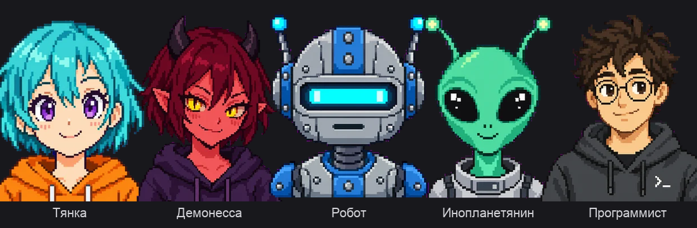

# x2ai-voice-avatar — персонаж с голосом в окне OpenCode Desktop

Локальная озвучка ответов агента плюс аниме-спрайт в левом нижнем углу окна,
который совпадает с голосом текущего чата: говорит, шевелит ртом ровно пока
звучит wav, моргает в тишине и отвечает короткой репликой на клик.

Всё работает офлайн: синтез — TeraTTSv2 (ONNX, CPU), без облака и без torch.



## Установка за 5 шагов

1. **TeraTTS**: модель `TeraSpace/TeraTTSv2` → `~/.config/opencode/teratts-model`,
   зависимости → `~/.config/opencode/teratts-venv` (подробности ниже).
2. **Сервер озвучки**: `cp x2ai-teratts/* ~/.config/opencode/x2ai-teratts/`,
   `chmod +x` на клиенты, проверка — `echo "Привет" | x2ai-teratts-speak`.
3. **Спрайты**: `python3 tools/build_sprites.py` — скачает модели
   `livliv-dev/player` и соберёт кадры (в репозитории их нет, см. «Лицензии»).
4. **Плагины**: `cp -r plugins/x2ai-tts-done.js plugins/x2ai-avatar ~/.config/opencode/plugins/`,
   затем `python3 tools/build.py` — склеит `gui-experimental.cjs`.
5. **Включить** в `~/.config/opencode/opencode.jsonc` (список `plugins`) и
   перезапустить окно. Правый клик по персонажу — следующий голос.

## Что внутри

| путь | что это |
| --- | --- |
| `plugins/x2ai-tts-done.js` | плагин озвучки: ловит конец ответа, делает короткий пересказ, согласует род, зовёт TeraTTS |
| `plugins/x2ai-avatar/gui.template.cjs` | GUI-плагин персонажа (шаблон без payload'ов) |
| `plugins/x2ai-avatar/gen-clicks.py` | генератор реплик на клик |
| `tools/build.py` | собирает `gui-experimental.cjs` из шаблона + payload'ов |
| `tools/build_sprites.py` | собирает кадры персонажей из моделей LivLiv |
| `tools/make_pack.py` | готовит свои кадры: маджента-фон → прозрачность, общая рамка, 336 px |
| `tools/make_preview.py` | рисует `docs/preview.png` (картинка выше) из `sprites.json` |
| `x2ai-teratts/server.py` | тёплый TTS-демон на unix-сокете |
| `x2ai-teratts/x2ai-teratts-speak` | клиент: `echo "текст" \| x2ai-teratts-speak` |
| `x2ai-teratts/x2ai-teratts-set` | сменить голос по умолчанию |

## Установка

1. **Модель и venv TeraTTS.** Скачать `TeraSpace/TeraTTSv2` с Hugging Face
   в `~/.config/opencode/teratts-model` (нужны `text_encoder.onnx`,
   `duration_predictor.onnx`, `sampler_distilled_cfg3_8step.onnx`,
   `vocoder.onnx`, `styles/`, `ruaccent/`, `teratts.py`, `unicode_indexer.json`)
   и поставить зависимости:

   ```sh
   python3 -m venv ~/.config/opencode/teratts-venv
   ~/.config/opencode/teratts-venv/bin/pip install \
     numpy onnxruntime transformers num2words huggingface_hub pillow
   ```

2. **Сервер и клиенты.**

   ```sh
   mkdir -p ~/.config/opencode/x2ai-teratts
   cp x2ai-teratts/* ~/.config/opencode/x2ai-teratts/
   chmod +x ~/.config/opencode/x2ai-teratts/x2ai-teratts-*
   echo "Привет, это проверка" | ~/.config/opencode/x2ai-teratts/x2ai-teratts-speak
   ```

   Первый вызов поднимает демон (загрузка модели ~7 с), дальше фраза
   синтезируется за 0.3–1.1 с.

3. **Плагины.** Скопировать `plugins/x2ai-tts-done.js` и каталог
   `plugins/x2ai-avatar` в `~/.config/opencode/plugins/`, затем собрать
   персонажа:

   ```sh
   cd ~/.config/opencode/plugins/x2ai-avatar
   ~/.config/opencode/teratts-venv/bin/python gen-clicks.py   # реплики на клик
   python3 /путь/к/репозиторию/tools/build.py                 # склейка в gui-experimental.cjs
   ```

   Спрайты в репозиторий не входят (см. «Лицензии»), их надо собрать
   локально скриптом `tools/build_sprites.py` — он скачивает модели
   `livliv-dev/player` и раскрашивает персонажей.

4. **Подключить в конфиге** `~/.config/opencode/opencode.jsonc`:

   ```jsonc
   {
     "plugins": [
       "~/.config/opencode/plugins/x2ai-tts-done.js",
       "~/.config/opencode/plugins/x2ai-avatar"
     ]
   }
   ```

## Голоса и персонажи

10 голосов, по одному на персонажа. Первые четыре — чистые голоса TeraTTS,
остальные — те же голоса с обработкой (питч, вибрато, кольцевая модуляция,
биткраш, перегрузка, реверб) в `server.py`.

| голос | персонаж | обработка |
| --- | --- | --- |
| `ru_f1` | Аня | — |
| `ru_f2` | Мила | — |
| `ru_m1` | Гриша | — |
| `ru_m5` | Тимур | — |
| `fx_robot` | Робик | кольцо 55 Гц, 7 бит |
| `fx_demon` | Демон | мужской: питч −20 %, драйв, реверб |
| `fx_demoness` | Демонесса | женский (база ru_f2): питч −16 %, вибрато, сильный драйв, реверб |
| `fx_alien` | Зета | питч +16 %, вибрато 5 Гц |
| `fx_cat` | Мурзик | питч +34 % |
| `fx_penguin` | Пико | питч +55 %, вибрато 7 Гц |
| `fx_ghost` | Юки | реверб 0.55 |

Голос чата выбирается хешем `sessionID` — и в плагине озвучки, и в плагине
персонажа одним и тем же кодом, поэтому картинка и голос не расходятся.

**Правый клик по персонажу** переключает на следующего вместе с его голосом
и запоминает выбор за текущим чатом в `~/.config/opencode/x2ai-voices.json`.
Озвучка читает этот файл и говорит выбранным голосом.

**Левый клик** проигрывает короткую заранее сгенерированную реплику
(10 фраз на голос, m4a внутри плагина). Новая реплика глушит предыдущую и
текущую озвучку ответа — одновременно звучит только один голос.

## Паки персонажей

Персонажи живут паками, пак выбирается в окне: наведите на персонажа и нажмите
шестерёнку — откроется список паков (`Название · сколько персонажей`).

| пак | источник | что внутри |
| --- | --- | --- |
| `pixel` | наши кадры в `custom/pixel/` | пока только Аня, остальные подставляются из «Аниме» |
| `anime` | модели LivLiv, собираются скриптом | все 10 персонажей |

Пак может быть неполным: если для голоса в активном паке кадров нет, плагин
берёт того же персонажа из `anime`. Так новый пак можно наполнять постепенно.

## Свои персонажи

Плагин не рисует рот и глаза отдельными слоями: он держит по одному **цельному
кадру** на каждое состояние и просто подменяет картинку. Поэтому свои персонажи
делаются как набор PNG-кадров одного размера, с прозрачным фоном и одинаковым
положением головы.

```
custom/<пак>/<голос>/closed.png   # рот закрыт, глаза открыты   — обязательно
custom/<пак>/<голос>/open.png     # рот открыт                  — обязательно
custom/<пак>/<голос>/half.png     # приоткрыт                   — необязательно
custom/<пак>/<голос>/round.png    # «о»                         — необязательно
custom/<пак>/<голос>/wide.png     # широко                      — необязательно
custom/<пак>/<голос>/blink.png    # глаза закрыты               — необязательно
custom/<пак>/<голос>/meta.json    # {"crop": [x0, y0, x1, y1]}  — необязательно
```

Чего нет — подставляется: `half`, `round`, `wide` берут `open.png`, `blink`
берёт `closed.png`. То есть минимум из двух кадров уже даёт шевелящийся рот,
просто без моргания и без разных форм рта.

Кадры масштабируются по высоте до 336 px, `meta.json` позволяет обрезать
лишние поля перед масштабированием. Кадры одинакового размера важны: иначе
голова будет «прыгать» между состояниями.

`<голос>` — это id из таблицы выше (`ru_f1`, `fx_cat`, …): так заменяется арт
для существующего голоса. Полностью новый персонаж требует ещё правки кода:
добавить id в `VOICES` и `NAMES` плагина персонажа, в `VOICES` плагина озвучки
и, если нужен эффект, обработку в `server.py`.

Сборка: положить кадры в `custom/` и прогнать
`python3 tools/build_sprites.py` — в выводе будет `<пак> <голос> custom N КБ`,
готовый `sprites.json` подхватится `tools/build.py`.

## Как окно узнаёт, что персонаж говорит

GUI-плагин в окне не имеет доступа к файлам и не может вызвать main-процесс
напрямую (`ctx.provide` с Ipc в экспериментальном API молча зависает).
Поэтому озвучка поднимает крошечный HTTP-мост на `127.0.0.1:47821`
(порт переопределяется `X2AI_BRIDGE_PORT`):

| маршрут | что делает |
| --- | --- |
| `GET /state` | `{speaking, ms, sid, voices}` — остаток текущей фразы, её чат и карта «чат → голос» |
| `POST /voice` | `{sid, voice}` — запомнить выбор персонажа за чатом |
| `POST /stop` | заглушить текущую озвучку |

Окно опрашивает `/state` раз в 250 мс и двигает губами только если
`sid` совпадает с открытым чатом — речь в другом чате анимацию не запускает.

**Если открыт правый блок** (панели вроде «Перевод рассуждений»), колонка
чата сужается и персонаж начал бы перекрывать поле ввода — на это время
он скрывается (`ctx.layout.side.opened()`).

## Род в пересказе

Пересказ ответа делается бесплатной моделью, и в промпт подставляется род
текущего голоса: женские голоса говорят «я проверила», мужские — «я проверил».
Отдельным правилом зафиксировано, что пользователь — мужчина: «ты проверил»,
«ты прав» остаются в мужском роде при любом голосе.

## Лицензии

- Код — MIT.
- Спрайты: персонажи LivLiv (livliv.ai), лицензия LivLiv Featured Characters
  1.0 — бесплатно для некоммерческого использования с указанием авторства.
  Поэтому готовые кадры в репозитории не публикуются: `tools/build_sprites.py`
  собирает их локально из публичных моделей `livliv-dev/player`.
- TeraTTSv2 — OpenRAIL-M, атрибуция TeraSpace.

## Отключить

Убрать плагины из `plugins` в `opencode.jsonc` либо создать
`~/.config/opencode/x2ai-tts-done.disabled`.

## Смоук-тесты

`python3 tools/smoke.py` — быстрая проверка, что ничего не сломано:
синтаксис шаблона, бандла, tts-плагина и server.py; обязательные блоки интерфейса
(рассуждения, модель, статистика, тихие часы); кадры спрайтов и реплики; деплой
в `~/.config/opencode`; ответы моста `/state`, `/speech`, `/user`, `/models`.
Код выхода 1, если что-то не на месте.
